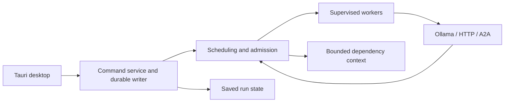

# MAOF_G4

**Multi-Agent Orchestration Framework — Group 4**

A focused Rust + Tauri desktop research prototype for coordinating local and
external agents. Contributors can run the existing engine and develop the missing
features across five research tracks. This is not a general-purpose assistant suite.

## Research tracks and implementation status

| ID | Track | Working foundation | Remaining work |
|---|---|---|---|
| R1 | Dependency- and resource-aware scheduling with priority support | Dependency validation; worker/RAM/token admission; FIFO, Round Robin, strict priority and aging; seeded experiments | Controlled live workloads, fairness analysis and cross-framework baselines |
| R2 | Task recovery and cancellation | Saved state; interrupted-run recovery; saved-ID A2A checks/cancellation where supported; confirmed/reserved/uncertain usage | More interoperability and failure-injection evaluation |
| R3 | Visual debugger for agent handoffs | Task outputs, decision timeline and run exports | Step snapshots, causal messages, failure labels, edit-and-fork replay |
| R4 | Dynamic tool selection for token efficiency | Scoped document-read/report tools and permissions | Tool catalog, keyword/vector selection, schema budget, live model/tool loop and benchmarks |
| R5 | Engine-mediated communication and message optimization | Bounded commands/results; reserved control/result capacity; dependency-scoped context | Message/context metrics and broadcast/full-history comparisons |

These are **proposed research contributions**, not established novelty or measured
performance improvements. Recovery, tool filtering, centralized coordination and
replay have prior implementations. Read [research scope and evidence](doc/RESEARCH_SCOPE.md)
before citing a claim. R3 and R4 are planned, not complete features.

## Run the desktop — Windows

Prerequisites: Rust with the MSVC toolchain, Microsoft C++ Build Tools, WebView2,
Node.js 22.12+, and Python 3.12+ for checks/optional external fixtures.

```powershell
git clone https://github.com/umayanga23/MAOF_G4.git
cd MAOF_G4
cd apps/desktop
npm ci
npm run tauri dev
```

The app starts in **Demo** mode with scripted outputs. No model, account or API key
is needed to test dependencies, scheduling, approvals and exports. **Research lab**
compares four policies on identical seeded simulated inputs.

For live local calls, start Ollama, install a model and set **every agent's model**
to an exact name returned by `ollama list`. Choose Local Ollama in Settings.
The live path runs bounded text-generation steps; model-selected tool execution
is not yet integrated.

Optional external fixture, in a separate terminal from the root:

```powershell
python examples/external_agent_server.py --port 8765
```

See [external-agent setup](doc/24-external-agents-si.md) and
[recovery/cancellation](doc/25-external-task-recovery-si.md). Keep credentials in
environment variables or ignored local files, never in the repository.

## Verify

From the root:

```powershell
python doc/tools/check_project_docs.py
python scripts/check_publish.py
cargo fmt --all -- --check
cargo test --workspace --locked
cargo build -p api --example ui_bridge --locked
cargo run -p api --example smoke -- .cache/my-smoke-workspace
cd apps/desktop
npm ci
npm run build
npm run test:ui
```

UI tests use installed Microsoft Edge and a bridge to the actual Rust service,
with isolated data under `.cache`. [Testing details](doc/TESTING.md).

Build an executable from `apps/desktop` with
`npm run tauri build -- --debug --no-bundle`. Output:
`target/debug/orchestration-desktop.exe`. Installer signing is outside this scope.

## Architecture and layout



| Location | Responsibility |
|---|---|
| `apps/desktop` | UI, desktop shell and integration tests |
| `crates/domain` | Shared agent/task/job/state contracts |
| `crates/orchestrator/src/prototype` | Step scheduling, admission, transitions and experiments |
| `crates/api` | Commands, bounded transport, durable publication and worker supervision |
| `crates/llm` | Local/external adapters and Agent Card discovery |
| `crates/storage` | Checkpoints and exports |
| `crates/observability` | Host CPU/RAM readings |
| `crates/tools` | Document adapters and permission checks |
| `crates/memory` | Bounded task/dependency context |

One active workflow is supported. Memory limits are admission checks, not OS
isolation. Remote cancellation is best effort. Local stale-result fences cannot
guarantee remote exactly-once execution.

## Contribute

The collaboration branch is **dev-umayanga**. Create a feature branch from it,
choose an R1–R5 task in the [roadmap](doc/ROADMAP.md), and open a PR targeting
`dev-umayanga`. Follow [CONTRIBUTING.md](CONTRIBUTING.md).

- [Focused architecture](doc/ARCHITECTURE.md)
- [Research scope and measurements](doc/RESEARCH_SCOPE.md)
- [Roadmap and acceptance criteria](doc/ROADMAP.md)
- [Documentation index](doc/README.md)

LMS/Gmail/Calendar helpers, obsolete full-system reports/diagrams and the unused
whole-run starter engine are excluded from active scope. Discovery, document
approvals, bounded memory and logical-resource guards remain supporting
infrastructure, not additional novelty claims.
