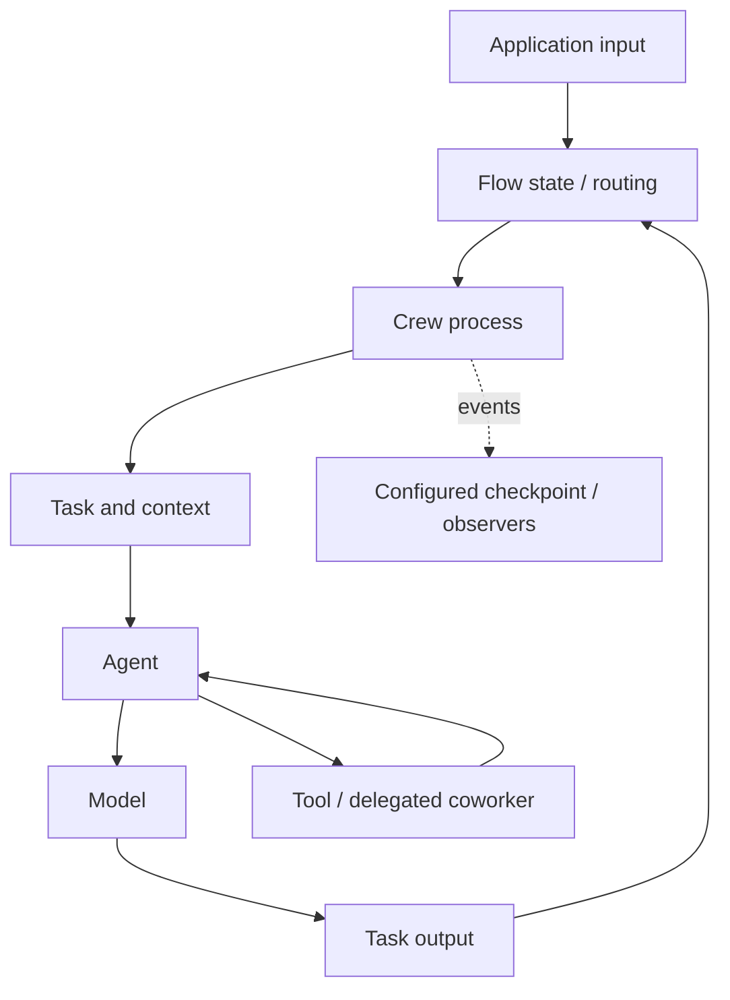

# CrewAI — orchestration, communication සහ runtime ක්‍රියා කරන විදිහ

> Scope update (2026-10-12): the five-track [research scope](RESEARCH_SCOPE.md) and [roadmap](ROADMAP.md) supersede older full-product plans. This guide retains its original review/test dates.

Review: **2026-10-11**. Sources: official **v1.15.27** documentation සහ public
Crew class source. Library behavior, hosted AMP features සහ අපේ design analysis
වෙන්කර දක්වා ඇත. SDK install/run හෝ performance benchmark කරලා නැහැ.
Overview: [comparison guide](33-orchestrator-framework-comparison-si.md).

## 1. Overall system එකේ parts

| Part | වගකීම |
|---|---|
| Agent | Role, goal, instructions/backstory, model සහ tools සමඟ task work කරන unit එක |
| Task | Work description, expected result, assigned agent, context සහ validation |
| Crew | Agents/tasks එකට ගෙන execution process ක්‍රියාත්මක කරන object එක |
| Flow | State සහ event/condition-driven application methods සම්බන්ධ කරන outer control layer එක |
| Model/tool adapters | Inference සහ actual external operations |
| Checkpoints/events | Configured saved state සහ execution observations |

Role/goal කියන්නේ operating-system process identity හෝ security permission
නොවේ. Crew object එක තිබීමෙන් machine resources automatically isolate වන්නේත්
නැහැ. Agent සහ task abstractions [Agents](https://docs.crewai.com/v1.15.27/en/concepts/agents),
[Tasks](https://docs.crewai.com/v1.15.27/en/concepts/tasks),
[Crews](https://docs.crewai.com/v1.15.27/en/concepts/crews) තුළ විස්තර වේ.

මෙය conceptual decomposition එකක්; exact internal call graph එකක් නොවේ.
Simple application එකකට outer Flow නැතිව Crew directly kickoff කළ හැකියි.

## 2. Orchestration තීරණ ගන්නේ කොහොමද?

**Sequential process:** declared task order අනුව වැඩ කරයි. Task එකේ selected
context මගින් earlier outputs භාවිත කළ හැකියි. **Hierarchical process:** configured
`manager_llm` හෝ `manager_agent` delegation සහ result review coordinate කරයි.
Manager-led task reasoning කියන්නේ FIFO/Round Robin/priority-aging host scheduler
එකක් නොවේ. [Processes](https://docs.crewai.com/v1.15.27/en/concepts/processes).

**Flow** එකේ `@start` entry method, `@listen` result/event listener සහ `@router`
condition-based branch භාවිත කළ හැකියි. Typed Pydantic state හෝ dictionary state
තබාගත හැකියි. Independent starts/listeners සහ `and_` joins මගින් application
dependencies model කළ හැකියි. Optional `@persist` state persistence සඳහායි;
default Flow persistence backend SQLite ලෙස docs දක්වයි.
[Flows](https://docs.crewai.com/v1.15.27/en/concepts/flows).

**Our example:** LMS read result valid නම් calendar preview method; invalid නම්
manual-review method. Reviewer revision ඉල්ලුවොත් improve branch එකට යා හැකියි.
Iteration cap developer විසින් define කළ යුතුයි. මෙය suggested design එකක්,
run කළ CrewAI example එකක් නොවේ.

## 3. Communication සහ context

Crew task communication සඳහා task outputs/context යොදාගනී. `context=[task_a,
task_b]` වැනි dependency list එකක් downstream taskට upstream results ලබාදෙයි.
Async upstream work අවසන් වීම downstream context consumptionට වැදගත්ය.
[Task context and async tasks](https://docs.crewai.com/v1.15.27/en/concepts/tasks).

`allow_delegation=True` නම් coworker delegation/question tools ලබාදෙනවා. Agent
model එක tool call එකෙන් task, context සහ coworker තෝරනවා; teammate result එක
callerගේ work සඳහා observation එකක් වෙනවා. ඒ නිසා හැම agent interaction එකම
standalone network message bus හරහා යන බව කියන්න බැහැ.
[Collaboration](https://docs.crewai.com/v1.15.27/en/concepts/collaboration).

Flow methods අතර state/result events ගෙනයෑම සහ agents අතර language-model context
හුවමාරුව එකම mechanism එකක් නොවේ. **Our analysis:** data schema, IDs සහ tool
permissions explicitව define කළොත් model text සහ executable control වෙන්කරගත
හැකියි; role name පමණක් authorization boundary එකක් ලෙස නොගන්න.

## 4. Runtime සහ concurrency

Crew starts via `kickoff()`. Reviewed docs native async `akickoff()` සහ
thread-based `kickoff_async()` වෙන්කරනවා; latter synchronous kickoff එක
`asyncio.to_thread` මගින් wrap කරනවා. Native async තිබීමෙන් sequential process
එකේ dependencies automatically parallel වෙන්නේ නැහැ. Task-level
`async_execution` සහ chosen process/Flow topologyත් සැලකිල්ලට ගන්න.
[Crew execution](https://docs.crewai.com/v1.15.27/en/concepts/crews).

Agent controls අතර `max_iter`, `max_execution_time`, `max_rpm`, retry settings
සහ context-window handling ඇත. මේවා iteration/time/rate controls; declared
RAM reservation හෝ unknown token-usage ledger එකට සමාන නොවේ. Crew-level RPM
controlත් ඇත. [Agent controls](https://docs.crewai.com/v1.15.27/en/concepts/agents),
[Crew configuration](https://docs.crewai.com/v1.15.27/en/concepts/crews).

Task guardrails output validate කර configured retry/rework ඉල්ලිය හැකියි.
Validation retry, failed model-call retry සහ external-effect retry වෙනම
concepts. Email send එකක reply නැති වුණාම output guardrail එකක් duplicate
delivery වැළැක්වීම guarantee කරන්නේ නැහැ. Last statement අපේ failure analysis.
[Task guardrails](https://docs.crewai.com/v1.15.27/en/concepts/tasks).

## 5. Persistence සහ failure behavior

Current checkpoint docs `Crew`, `Flow`, `Agent` configured checkpoint snapshots,
event triggers, inherited configuration සහ JSON/SQLite providers විස්තර කරනවා.
**Automatic event-driven checkpoint write failure best-effort** ලෙස log කර run
continue කරන බවත් manual checkpoint calls failure re-raise කරන බවත් explicitව
සඳහන් කරනවා. Configured snapshot restore/fork support ඇත.
[Checkpointing](https://docs.crewai.com/v1.15.27/en/concepts/checkpointing).

Flow `@persist` state persistence සහ execution checkpointing එකක් ලෙස හැමවිටම
එකම guarantees assume නොකරන්න. **Our analysis:** external action accepted වී
checkpoint save වෙන්න කලින් crash වුණොත් service-side task/message ID සහ
reconciliation අවශ්‍යයි. Snapshot තිබීම remote exactly-once effect proof නොවේ.

මෙය අපේ writer සමඟ සැලකිය යුතු design difference එකක්: අපේ
[async writer](30-async-durable-writer-si.md) failed save එකක old published state
තබා new dispatch freeze කරනවා. ඒක “CrewAI unreliable” කියන conclusion එකක්
නොවේ; different configured failure contracts සසඳන observation එකක් පමණයි.

## 6. External agents, tools සහ human decisions

**A2A:** reviewed API remote agents සඳහා Agent Card/execution connection සහ
remote delegation දෙයි; `A2AClientConfig` / `A2AServerConfig` documentation ඇත.
Streaming/polling/push options transport behavior වෙනස් කරනවා. Auth/client setup
සහ server compatibility තව අවශ්‍යයි.
[A2A delegation](https://docs.crewai.com/v1.15.27/en/learn/a2a-agent-delegation).

**MCP:** configured MCP serversගේ tools crew agentsට expose කරයි. Remote tool
කියන්නේ independent agent එකක් යැයි assume නොකරන්න.
[MCP integration](https://docs.crewai.com/v1.15.27/en/mcp/overview).

Task human input සහ Flow feedback methods library mechanisms වේ. Hosted HITL
guideහි execution IDs, webhook, Pending Human Input සහ resume endpoint workflow
**hosted Enterprise deployment context** තුළයි. Local Python script එකකට ඒ hosted endpoint
ස්වයංක්‍රීයව ලැබෙන්නේ නැහැ.
[Hosted HITL](https://docs.crewai.com/v1.15.27/en/learn/human-in-the-loop),
[Flow feedback](https://docs.crewai.com/v1.15.27/en/concepts/flows).

## 7. Events සහ implementation evidence

Event listeners මගින් crew/task/tool lifecycle observations ලබාගත හැකියි.
Observability event එක downstream task permission එකක් හෝ durable commit ACK එකක්
ලෙස භාවිත කරනවාද කියන එක application contract එකෙන් තීරණය කළ යුතුයි.
[Event listeners](https://docs.crewai.com/v1.15.27/en/concepts/event-listener).

Public `Crew` definition තුළ agents/tasks, process, manager configuration,
callbacks, usage metrics සහ checkpoint configuration fields පරීක්ෂා කළා.
Full executor/collaboration internals audit කළේ නැහැ; older tutorialsහි private
method names current version සඳහා confirm කළ ලෙස මෙහි දක්වා නැහැ.
[Reviewed Crew source](https://github.com/crewAIInc/crewAI/blob/main/lib/crewai/src/crewai/crew.py).

## 8. CrewAI-specific design සහ අපේ projectට ගත හැකි දේ

මේවා එහි characteristic abstractions; exclusive inventions කියන claim එකක් නොවේ.

| Design | අපේ interpretation / possible use |
|---|---|
| Role/task Crew plus outer Flow | Deterministic account operations වෙන්කර agent reasoning task ලෙස encapsulate කිරීම |
| Coworker delegation tools | Nested delegation එකක් implement කළොත් parent/task IDs සහ separate budgets තබන්න |
| Manager-led hierarchy | Flexible planning; extra manager calls සහ validation cost measure කරන්න |
| Guardrails + typed outputs | LMS deadlines වැනි model outputs schema/domain validationට යොමු කරන්න |
| A2A/MCP integration | Existing external agent connector සහ future tool registry වෙනම තබන්න |
| Checkpoint failure contract | Persist-before-dispatch invariant සමඟ matched fault scenario compare කරන්න |

**Research boundary:** reviewed sources අපේ exact resource/fairness/uncertain
budget policy නොපෙන්වීම framework ecosystem එකට එය implement කළ නොහැකි බවට
proof එකක් නොවේ. Controlled comparison plan [main guide](33-orchestrator-framework-comparison-si.md) තුළයි.
