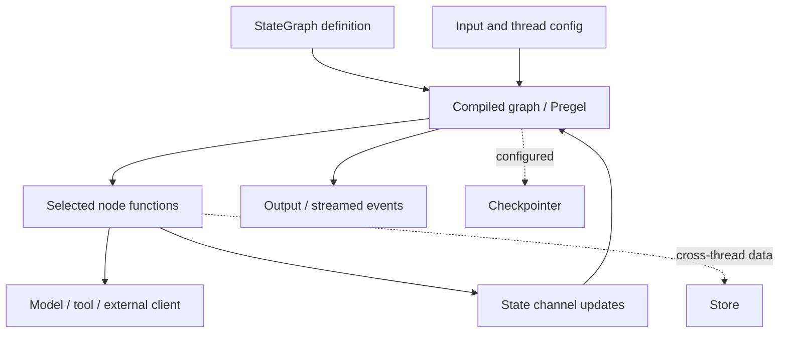

# LangGraph — orchestration, communication සහ runtime ක්‍රියා කරන විදිහ

> Scope update (2026-10-12): the five-track [research scope](RESEARCH_SCOPE.md) and [roadmap](ROADMAP.md) supersede older full-product plans. This guide retains its original review/test dates.

Official Python documentation review: **2026-10-11**. Exact package release එකක්
install/test කළේ නැහැ. මේක Graph API/Pregel explanation එකක්; hosted deployment
හෝ LangChain agent defaults සියල්ල LangGraph library behavior ලෙස සලකන්නේ නැහැ.
Overview: [comparison guide](33-orchestrator-framework-comparison-si.md).

## 1. Overall system

LangGraph තුළ agent එකක් අනිවාර්ය special process එකක් නොවේ. Node function එක
model call එකක්, tool call එකක්, pure computation එකක් හෝ sub-workflow එකක්
විය හැකියි. `StateGraph` state schema, nodes සහ edges define කර compile කළ පසු
runtime execute කරනවා. Fixed edges සහ conditional routes control flow දක්වයි.
[Graph API](https://docs.langchain.com/oss/python/langgraph/graph-api).



Diagram එක conceptualයි. Checkpointer සහ Store එකට වෙනස් responsibilities ඇත;
model/provider clients සහ deployment worker processes graph definition එකෙන්
වෙනම configure කරනවා.

## 2. Orchestration සහ graph control

State යනු current data snapshot; node යනු work; edge යනු next-work rule.
Conditional edge result එකෙන් branch තෝරයි. `Send` dynamic fan-out සඳහා,
`Command` state update/control transfer සඳහා භාවිත කළ හැකියි. Cycles සහ
subgraphs model කළ හැකියි; recursion/step limit සහ exit rules තබන්න.
[Graph control](https://docs.langchain.com/oss/python/langgraph/graph-api).

**Our example:** LMS node → deadline normalization → calendar preview → approval
→ calendar write. Inbox node independent branch එකක් ලෙස digest හදයි.
No due date තිබුණොත් unknown-date/manual-review route එක තෝරන්න. මෙය අපේ
proposed topology එකක්; real LMS adapter implementation එකක් නොවේ.

Node එකක LLM භාවිත කළත් branching rule එක deterministic Python function එකක්
විය හැකියි. Model-generated plan එකකට unrestricted execution permission
ලැබෙන්නේ නැහැ; policy validation application code තුළ යෙදිය යුතුයි.
මේ policy consequence අපේ analysis එකකි.

## 3. Communication: state, channels සහ reducers

Nodes state updates return කරනවා; state keys සඳහා reducers updates merge කරනවා.
Default replacement සහ explicit accumulation වෙනස් semantics දෙයි. Parallel
branches එකම field update කරන විට compatible reducer/schema අවශ්‍යයි.
`MessagesState` වැනි message-oriented state තිබුණත් හැම channel value එකම chat
message එකක් නොවේ. Private schema field එකක් security redaction guarantee නොවේ;
stream output selectionත් සලකා බලන්න.
[State/reducers](https://docs.langchain.com/oss/python/langgraph/graph-api).

Underlying runtime actors channels read/write කරනවා. Channel types අතර
`LastValue`, configurable `Topic` සහ aggregate channels තිබෙනවා. Graph message
passing යනු runtime state propagation; එය HTTP/A2A remote transport එකක් බවට
ස්වයංක්‍රීයව පත් නොවේ.
[Pregel channels](https://docs.langchain.com/oss/python/langgraph/pregel).

## 4. Runtime: Pregel super-step එක

Reviewed runtime **Bulk Synchronous Parallel** structure භාවිත කරනවා:

1. **Plan:** input/updated channels අනුව මේ step එකේ active actors තෝරන්න.
2. **Execute:** selected actors parallelව run කරන්න; completion, failure හෝ timeout boundary එන තෙක්.
3. **Update:** returned writes channelsට apply කරන්න. Execution phase අතර writes අනෙක් actorsට next step වන තෙක් නොපෙනේ.

No selected actors හෝ configured step limit ආවම run loop අවසන් වෙයි.
[Pregel execution](https://docs.langchain.com/oss/python/langgraph/pregel).

මේක conceptual pseudocode; SDK/source code copy එකක් නොවේ:

```text
while graph has scheduled work and limits permit:
    selected = plan_from_channel_changes()
    writes = execute_selected_nodes(selected)
    apply_channel_updates(writes)
    persist_according_to_configured_backend_and_durability()
```

**Our analysis:** super-step ordering, task priorities සහ OS CPU time slicing
වෙනස් concepts. Parallel fast branch එකේ downstream behavior barrier/control
topology නිසා බලපෑමට ලක්විය හැකියි. අපේ admitted step coordinator එක සමඟ compare
කරද්දී graph shape සහ node granularity සමාන කරන්න.

## 5. Concurrency, errors සහ retries

Graph invocation configහි top-level `max_concurrency` concurrent work limit
configure කරනවා. Nodesට `RetryPolicy` යෙදිය හැකියි; retry predicate, attempts
සහ backoff තෝරන්න. Reviewed current how-to එක timeout/error-handler optionsත්
පෙන්වනවා; ඒවා package-version dependent නිසා implementationකට pinned API
confirm කළ යුතුයි.
[Concurrency and retry configuration](https://docs.langchain.com/oss/python/langgraph/use-graph-api).

Error එක retry කළ හැකි වීම remote write එක safe to replay බවට proof නොවේ.
Read timeout සහ accepted-but-response-lost email/calendar write අතර වෙනස
applicationට හඳුනාගත යුතුයි. Idempotency/reconciliation සහ effect IDs අවශ්‍ය
වීම අපේ failure analysis; graph retry option එක ඒවා වෙනුවට භාවිත නොකරන්න.

## 6. Persistence සහ recovery

Checkpointer thread-scoped graph state save කරනවා; thread identity continuity
සඳහායි. Store application-defined cross-thread data සඳහා වෙනම abstraction
එකක්. In-memory saver process restart durability දෙන්නේ නැහැ; persistent
backend configure කළ යුතුයි.
[Persistence](https://docs.langchain.com/oss/python/langgraph/persistence).

Super-step checkpoints සහ individual completed task writes save කළ හැකියි.
Same super-stepහි වෙනත් node එක fail වුණත් successful nodesගේ pending writes
තබා recoveryහි ඒ successful work නැවත run නොකිරීම support කරනවා.
Durability modes අතර synchronization/latency tradeoffs ඇත; configuration අනුව
crash window වෙනස් වන නිසා සියලු modes එකම guarantee ලෙස නොකියන්න.
[Checkpointers and pending writes](https://docs.langchain.com/oss/python/langgraph/checkpointers).

| Durability mode | Documented write boundary |
|---|---|
| `sync` | Next graph stepට පෙර checkpoint save |
| `async` | Next step execute වන අතර checkpoint save; crash gap තිබිය හැකියි |
| `exit` | Run exit/error/interrupt boundaryහි save; mid-run process crash recovery සීමිතයි |

මේ boundaries graph state සඳහායි, external service transactions සඳහා නොවේ.
[Durability modes](https://docs.langchain.com/oss/python/langgraph/checkpointers#durability-modes).

Local state restore සහ remote action outcome restore එක සමාන නැහැ. Node code
side effects task boundaries/IDs සමඟ design කළ යුතුයි. Sample account writes
සඳහා exactly-once claim එකක් මේ review එකෙන් ලැබෙන්නේ නැහැ.

## 7. Human approval: interrupt/resume

`interrupt(payload)` human/application input බලා graph pause කරයි. Checkpointer
සහ same `thread_id` සමඟ `Command(resume=...)` භාවිත කර continue කරනවා.
**Resume වෙද්දී interrupted node එකේ මුල සිට code නැවත run වෙනවා**; interruptට
පෙර operations නැවත execute විය හැකියි. ඒ නිසා external writes approvalට පෙර
කරලා තැබීම වැරදි pattern එකක් විය හැකියි.
[Interrupt semantics](https://docs.langchain.com/oss/python/langgraph/interrupts).

**Our suggested design:** preview build → exact payload approval → separate
idempotent/reconciled write node. Recipient/calendar ID/title/time/body approved
payload එකෙන් පසු වෙනස් වුණොත් new approval request එකක් ඉල්ලන්න. Approval
resume value එක arbitrary account permission upgrade එකක් නොවිය යුතුයි.

## 8. Streaming සහ deployment boundary

Stream modes අතර `updates` state changes, `values` snapshots, `messages` model
token chunks, `custom` app progress සහ checkpoint/task/debug observations ඇත.
Model client support සහ chosen mode අනුව stream එකේ contents වෙනස් වේ.
UI snapshots පෙන්වීම token streaming ලෙස claim නොකරන්න.
[Streaming](https://docs.langchain.com/oss/python/langgraph/streaming).

Library එක process තුළ graph execute කරන abstraction එකයි. Agent Server/
LangSmith deployment සහ tracing infrastructure වෙනම product/configuration
boundary වේ. Pure LangGraph workflow එකකට hosted platform අනිවාර්ය නොවේ.
[LangGraph overview](https://docs.langchain.com/oss/python/langgraph/overview).

## 9. LangGraph-specific design සහ අපේ projectට lessons

| Characteristic design | අපේ analysis / possible use |
|---|---|
| Explicit state schema + reducers | Branch results structured fields ලෙස merge කර implicit string-context errors අඩු කරන්න |
| Plan/execute/update barrier | Deterministic visibility boundary; latency tradeoff graph topology අනුව measure කරන්න |
| Conditional edges / Command / Send | Proposed review loops සහ dynamic workflowsට reference එකක් |
| Pending task writes | Concurrent successful work crash recoveryහි දෙවරක් repeat නොකිරීමට design reference |
| Persistent interrupts | Human decisions durable state ලෙස model කරන්න; resumed pre-effect code review කරන්න |
| Separate Store/checkpointer | Long-term retrieval memory සහ run checkpoint ownership වෙන්කරන්න |

මේ ideasහි integration value ඇත; graph persistence/human approval තනිවම අපේ
research novelty ලෙස claim කරන්න බැහැ. Current project gaps
[comparison mapping](33-orchestrator-framework-comparison-si.md) තුළයි.
