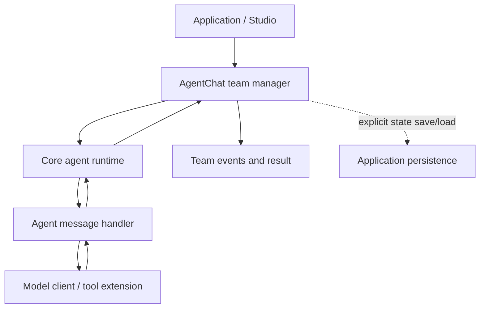

# AutoGen — orchestration, communication සහ runtime ක්‍රියා කරන විදිහ

> Scope update (2026-10-12): the five-track [research scope](RESEARCH_SCOPE.md) and [roadmap](ROADMAP.md) supersede older full-product plans. This guide retains its original review/test dates.

Review: **2026-10-11**. Official **stable Core/AgentChat** docs සහ generated runtime
source පරීක්ෂා කළා. Old 0.2 conversation API මේ explanation එකට mix කරලා නැහැ.
Packages install/run හෝ throughput benchmark කරලා නැහැ.
Overview: [comparison guide](33-orchestrator-framework-comparison-si.md).

Official repository review දිනට AutoGen **maintenance mode**, community-managed
bug/security/documentation work සහ new projects සඳහා Microsoft Agent Framework
recommendation දක්වයි. Historical architecture analysis එකට AutoGen අදාළයි;
new framework එකේ features AutoGenට attribute කරන්නේ නැහැ.
[Repository status](https://github.com/microsoft/autogen).

## 1. Overall layers

| Layer | වගකීම |
|---|---|
| Core | Event-driven agents, identities, handlers, messages සහ runtime contracts |
| AgentChat | Conversational agents සහ team orchestration built on Core |
| Extensions | Model clients, tools/workbenches, code executors සහ external integrations |
| Studio | AgentChat-based prototyping UI; runtime library එකට සමාන product එකක් නොවේ |

[Official architecture entry](https://microsoft.github.io/autogen/stable/index.html).



Custom Core-only application එකකට AgentChat manager අවශ්‍ය නැහැ. Layers වෙන්
කරලා බලන එක specific responsibility එකක් සසඳන්න උදව් කරනවා.

## 2. Orchestration: team manager සහ next speaker

`RoundRobinGroupChat` participantsට turn order අනුව work දෙයි; responses team
contextට යයි. මෙය conversational turns; OS time slices හෝ RAM-aware task
admission එකක් ලෙස නොගන්න.
[Teams](https://microsoft.github.io/autogen/stable/user-guide/agentchat-user-guide/tutorial/teams.html).

`SelectorGroupChat` shared context සහ participant descriptions අනුව model එකෙන්
next speaker තෝරයි. Custom selector/candidate functions දිය හැකියි. Selected
agent response broadcast කළ පසු termination condition check කර තවත් speaker
තෝරනවා. Selector model calls evaluation cost එකට ඇතුළත් කළ යුතුයි.
[Selector Group Chat](https://microsoft.github.io/autogen/stable/user-guide/agentchat-user-guide/selector-group-chat.html).

`Swarm` agentsගේ `HandoffMessage` මගින් active-agent transitions පාලනය කරයි.
Routing instructions සහ compatible model/tool behavior වැදගත්ය.
[Swarm](https://microsoft.github.io/autogen/stable/user-guide/agentchat-user-guide/swarm.html).

Structured dependency/branch/loop workflows සඳහා `GraphFlow` සහ
`DiGraphBuilder` ඇත. Reviewed docs එය **experimental** ලෙස mark කරනවා. AutoGen
සියල්ල free-form chat පමණක් කියන explanation එක වැරදියි.
[GraphFlow](https://microsoft.github.io/autogen/stable/user-guide/agentchat-user-guide/graph-flow.html).

## 3. Communication: direct messages සහ pub/sub

Core messages serializable data objects විය හැකියි. `RoutedAgent` + typed
`@message_handler` message type අනුව handler select කරනවා.
`send_message` recipient `AgentId` වෙත request යවා await කළොත් handler result
ලබයි; direct handler exception senderට propagate විය හැකියි.
`publish_message` topic subscribersට one-way delivery සඳහායි; subscriber return
value publisherගේ request/response result එකක් වෙන්නේ නැහැ.
[Message and communication](https://microsoft.github.io/autogen/stable/user-guide/core-user-guide/framework/message-and-communication.html).

Topic type/source සහ subscriptions recipient instances identify/rout කරනවා.
Pub/sub සහ direct response handling වෙනම protocols නිසා missing reply සහ
subscriber failure එකම error contract එකකට map නොකරන්න.
[Topics/subscriptions](https://microsoft.github.io/autogen/stable/user-guide/core-user-guide/core-concepts/topic-and-subscription.html).

Agent ID එක type + key එකෙන් instance identify කරයි. Registered factory එකෙන්
runtime අවශ්‍ය agent instance lazily create කළ හැකියි. Agent type name පමණක්
account permission එකක් නොවේ.
[Identity/lifecycle](https://microsoft.github.io/autogen/stable/user-guide/core-user-guide/core-concepts/agent-identity-and-lifecycle.html).

## 4. Standalone runtime execute කරන විදිහ

`SingleThreadedAgentRuntime` single asyncio queue භාවිත කරනවා. Queue delivery
order සහ handler completion order සමාන guarantee නොවේ: each message handling
වෙනම asyncio task එකක් ලෙස concurrentව process කළ හැකියි. “SingleThreaded”
කියන්නේ every handler fully sequential කියන එක නොවේ. Docs මෙය standalone/
development සඳහා සුදුසු බවත් high-throughput/high-concurrency සඳහා නොවන බවත්
දක්වයි.
[Runtime API](https://microsoft.github.io/autogen/stable/reference/python/autogen_core.html).

Generated implementationහි send/publish/response envelopes, direct-response
Future, cancellation token, queue put/get, background tasks සහ handler exception
paths පරීක්ෂා කළා. Lifecycle methods start, stop/idle handling සමඟ queue work
manage කරනවා. **Queue transport එක durable broker එකක් බව මේ inspection එකෙන්
claim කරන්නේ නැහැ.**
[Reviewed runtime source](https://microsoft.github.io/autogen/stable/_modules/autogen_core/_single_threaded_agent_runtime.html).

Reviewed implementation queue එක `Queue()` ලෙස explicit maximum size නැතිව
construct කරනවා. එය අපේ byte/count-bounded transport contract එකට සමාන නොවේ;
වෙනත් runtime implementations ගැන generalize නොකරන්න. `stop()` සහ
`stop_when_idle()` එකම drain behavior නොදෙයි: idle stop outstanding work නැති
boundary එක බලා සිටිනවා. Source-version-specific behavior application testsහි
verify කරන්න. [Runtime implementation](https://microsoft.github.io/autogen/stable/_modules/autogen_core/_single_threaded_agent_runtime.html).

Conceptual flow; copied SDK code නොවේ:

```text
sender -> message envelope -> runtime queue
runtime -> identify/create recipient -> async handler
direct request -> response Future -> waiting sender
publish -> matching subscriptions -> handlers (no direct response)
```

## 5. Distributed runtime

Standalone runtime agents same process තුළයි. Distributed design එක host
service සහ worker runtimes වෙන්කරයි; workers agents advertise කරයි, host
connections/routing coordinate කරයි.
[Runtime environments](https://microsoft.github.io/autogen/stable/user-guide/core-user-guide/core-concepts/architecture.html).

gRPC-based distributed runtime extra extension dependencies භාවිත කරනවා.
Docs එය **experimental** බව සහ breaking API changes ඇති විය හැකි බව දක්වයි.
එය arbitrary REST/A2A agent URL එකක් register කිරීමෙන්ම compatible වන බවට
claim නොකරන්න.
[Distributed runtime](https://microsoft.github.io/autogen/stable/user-guide/core-user-guide/framework/distributed-agent-runtime.html).

## 6. Runtime control සහ termination

Team run result සහ event stream ලබාගත හැකියි. Team continuation/reset සහ
cancellation behavior තෝරාගත් preset සහ token handling අනුව බලන්න.
[Team controls](https://microsoft.github.io/autogen/stable/user-guide/agentchat-user-guide/tutorial/teams.html).

Termination conditions අතර message count, selected text, timeout, external
termination, handoff සහ `TokenUsageTermination` ඇත. Token termination සඳහා
agents usage report කළ යුතුයි. Conditions combine කළ හැකියි. මේක usage-based
stop control; unknown-call reservation ledger එකක් බව assume නොකරන්න.
[Termination](https://microsoft.github.io/autogen/stable/user-guide/agentchat-user-guide/tutorial/termination.html).

**Our analysis:** cancellation token එක local awaited operation cancel කළත්
remote API action undo වීම guarantee නොවේ. Graceful conversation termination,
abrupt task cancellation සහ confirmed remote cancel වෙන්කර record කරන්න.
Framework name එකට වඩා model/tool adapter contract වැදගත්ය.

## 7. Saved state, human input සහ tools

Agent/team `save_state` සහ `load_state` APIs state capture/restore සඳහායි.
Team snapshot තුළ participants/manager state තිබිය හැකියි. Returned dictionary
durable storage එකකට ලිවීම application responsibility; in-memory dictionary
එකක් save කළා කියලා disk crash recovery ලැබෙන්නේ නැහැ. Snapshot එක stable
boundary එකකදී ගන්න.
[Managing state](https://microsoft.github.io/autogen/stable/user-guide/agentchat-user-guide/tutorial/state.html).

Human interaction සඳහා user agent හෝ user-targeted handoff සමඟ stop/continue
patterns design කළ හැකියි. **Our suggested write workflow:** manager publish
කරන proposal එකට exact payload ID එකක් දෙන්න; authorized approval message එක
ලැබුණු පසුව tool handler execute කරන්න. Arbitrary conversation text approval
ලෙස භාවිත නොකරන්න. මේක අපේ design proposal, default built-in guarantee නොවේ.

Extensions තුළ model clients, MCP workbench සහ code executor integrations ඇත.
External tool call, Core agent message සහ independent remote-agent protocol එක
වෙනම concepts ලෙස සලකන්න.
[Extensions overview](https://microsoft.github.io/autogen/stable/index.html).

## 8. AutoGen-specific design සහ අපේ projectට lessons

| Characteristic design | අපේ interpretation / possible use |
|---|---|
| Core / AgentChat / Extensions split | Communication/runtime module සහ task-policy coordinator වෙනම තබන්න |
| Direct response vs topic publishing | Required result/ACK සහ observation events එකම lane/contract එකක් නොකරන්න |
| Type/key agent identity | Parent run/task/attempt IDs සමඟ compatible service identity model එකක් තබන්න |
| Replaceable team selection | Deterministic selector සහ LLM selector costs/reproducibility වෙනම evaluate කරන්න |
| Concurrent handler tasks | Queue dequeue order එක completion/fairness proof නොවන බව testsවල පැහැදිලි කරන්න |
| Explicit state snapshots | Durable save-before-ACK policy implementation evidence සමඟ වෙන්කර compare කරන්න |

අපේ bounded transportහි reserved Stop/approval capacity සහ worker result-slot
admission [runtime guide](29-bounded-runtime-si.md) තුළයි. ඒ guarantees AutoGen
default runtimeට තිබෙනවා/නැහැ කියලා universal claim එකක් මේ source review එකෙන්
කරන්නේ නැහැ. Version-pinned load/failure tests අවශ්‍යයි.
