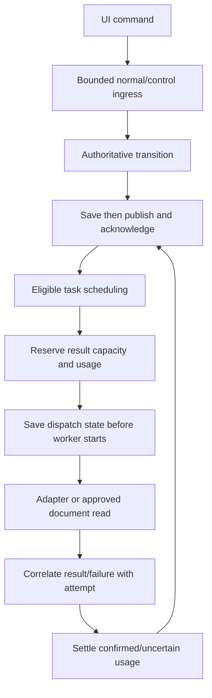

# Focused architecture

The desktop uses `api::desktop::Service` and `orchestrator::prototype`. Each live
local model step is one Ollama text-generation call. The unused whole-run starter
engine has been removed from this scoped repository.

## Contracts

- Prerequisites complete before a task's model steps become eligible.
- Same-agent work is serialized; independent agents run within admitted capacity.
- Memory admission uses declared estimates and host readings, not OS quotas.
- Confirmed, reserved and uncertain usage affect future admission.
- Control/result transport is bounded. Stop admission is not an immediate ACK guarantee.
- Save failure prevents new dispatch; an owned commit survives caller cancellation.
- Saved A2A IDs permit reconciliation; remote cancellation remains best effort.
- Workers report through the engine; downstream context is bounded and scoped.

Document reads/reports exercise concrete permissions. Memory provides task-private
and dependency-visible context. Discovery/capabilities support external registration.
Demo logical-resource guards remain for test/checkpoint compatibility, but their
dedicated demonstration screen is excluded from the UI.

## Planned boundaries

R3 needs dispatch/result history and forks; current snapshots/events are not a replay
journal. R4 needs schemas and structured tool calls; the current adapter sends text
messages without selected tool schemas. R5 needs counters before savings are measured.

Detailed guides: [bounded runtime](29-bounded-runtime-si.md),
[durable writer](30-async-durable-writer-si.md), [recovery](25-external-task-recovery-si.md).
